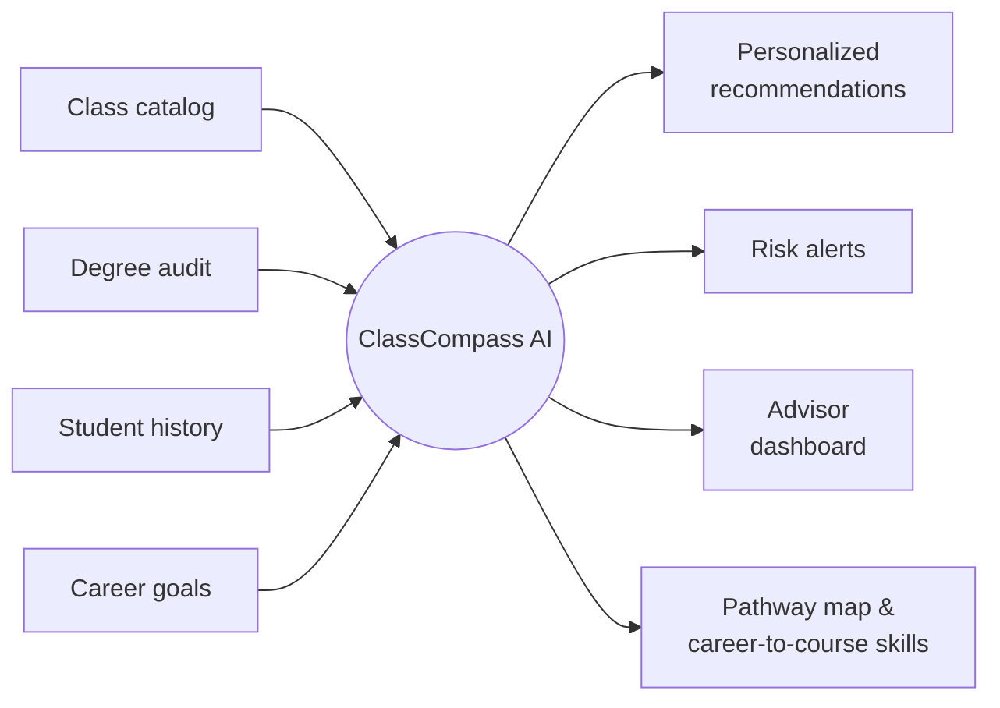
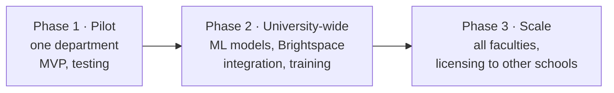

# ClassCompass AI: Redesigning Academic Advising with Design Thinking

**From reactive to predictive advising, built on the systems the university already runs.**

`Design Thinking` · `Stakeholder analysis` · `Solution design` · `Phased rollout`
Carleton University, TIMG 5001, "Hack the University" Challenge · with Katelyn Butts

---

## Problem

> There is no unified, predictive advising system that supports informed course planning at scale.

Students struggle to choose the right courses. Advisors juggle repetitive admin work across disconnected systems.

## Stakeholders & what we heard

| Stakeholder | Pain point | In their words |
|---|---|---|
| Students | Too many options, fear of the "wrong" choice | "There are too many courses; I don't know what fits my goals." |
| Advisors | Manual prerequisite checks, no early risk visibility | "We spend hours checking prerequisites manually." |
| University | Delayed graduations, enrolment bottlenecks | Students feel "digitally homeless" across fragmented systems |
| Faculty & IT | Fear of losing autonomy; integration cost | IT warns about integration complexity |

## How Might We…

- **For students:** provide personalized, data-driven course recommendations that keep them on track for their academic and career goals?
- **For advisors:** automate routine admin so advisors can focus on proactive, high-value support?

## Solution

Built on existing systems (Banner, Degree Audit, Brightspace APIs), so nothing has to be replaced.

## Why it wins

| Criterion | How ClassCompass performs |
|---|---|
| Student experience | Personalized guidance removes confusion |
| Faculty autonomy | Advisors make final decisions; the tool supports them, it doesn't replace them |
| Technical feasibility | Uses existing university systems and APIs |
| Privacy | Data minimization, opt-in analytics |
| Equity | Reduces advising gaps for international and first-generation students |

## Costs & rollout

| Item | Estimate |
|---|---|
| Machine learning services | $300–$800 CAD / month |
| Development | 300–400 hours |
| Training programs | $1,500–$3,000 CAD |
| Ongoing support | $500–$1,000 CAD / month |

**Expected impact:** 30–40% fewer repetitive advisor tasks; faster graduations; better retention.

## Risks & mitigation

| Risk | Mitigation |
|---|---|
| Advisor resistance | Involve advisors in design; position it as support |
| Privacy concerns | Transparent data policies, opt-in analytics |
| Integration complexity | Staged rollout, IT governance |
| Peak registration load | Load testing, scalable infrastructure |

## My role
<!-- Edit to describe your exact part -->
Team of two with Katelyn Butts. We developed and co-presented the solution together.

## Files
- [`presentation.pdf`](presentation.pdf): final pitch deck
